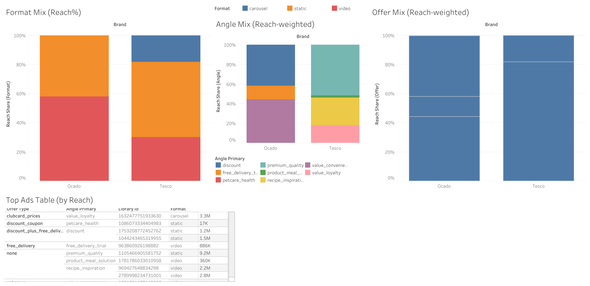

# Tesco vs Ocado: UK Online Grocery Growth Audit

> Where is Ocado losing ground online, and which 10 experiments should come first?

**Independent audit from public sources only (October 2026). No affiliation with Tesco, Ocado or Sainsbury's.**

## Three workstreams

1. **Website performance.** Google Lighthouse on 10 pages: five from Ocado (category, search, basket, product) and five from Sainsbury's (home, search, product, login wall).
2. **Paid social creative.** 10 live Meta Ad Library ads, Ocado vs Tesco, compared by format, angle and offer, weighted by reach.
3. **Growth experiments.** 10 proposed tests across acquisition, site speed, checkout and retention, ranked with ICE (Impact, Confidence, Ease).

## Findings

| Area | Finding |
|---|---|
| Site speed | Ocado's five tested pages scored **32 to 37** (average **33.8**). Sainsbury's five scored **36 to 61** (average **49.8**). Ocado's basket page had a 28.8 second Largest Contentful Paint. |
| Hot spots | Search and basket were the weakest steps, which matters because they sit right before checkout. |
| Ads | The Ocado sample leaned on value, discounts and free delivery. Tesco's mixed premium quality, recipe inspiration, Clubcard loyalty and meal solutions. |
| Priorities | Top ICE score was **7.33 out of 10**: improving Ocado's category page speed. Search speed (7.00) and basket speed (6.67) followed. |

## Method

- Lighthouse results are in `data/lighthouse_tests.csv`. Scores vary run to run, so treat them as a range.
- Ads are in `data/meta_ad_library_sample.csv`, with Meta Ad Library IDs and reach estimates.
- Experiments, with hypotheses, KPIs and ICE scores, are in `data/experiments_ice_scored.csv`.
- The Tableau workbook is in `tableau/`. The full written report is in `docs/`.

## Honest limits

- Ten pages and ten ads are small samples. They show patterns, not proof.
- The page types for Ocado and Sainsbury's were **not fully matched**, so the speed gap is indicative, not a like for like benchmark.
- Reach is not additive and does not equal conversion or ROAS.
- Public ad data shows what runs, not what works. I have no access to either company's analytics, so experiment sizing is judgment.

## Files

| Path | What it is |
|---|---|
| `data/` | Lighthouse results, ad sample, ICE-scored experiments |
| `tableau/` | Tableau workbook for the site speed benchmark |
| `images/` | Dashboard export |
| `docs/` | Written growth intelligence report |

## Contact

[LinkedIn](https://www.linkedin.com/in/vareshnirbhavne) | [Portfolio](https://vareshportfolio.vercel.app) | vareshworks@gmail.com
